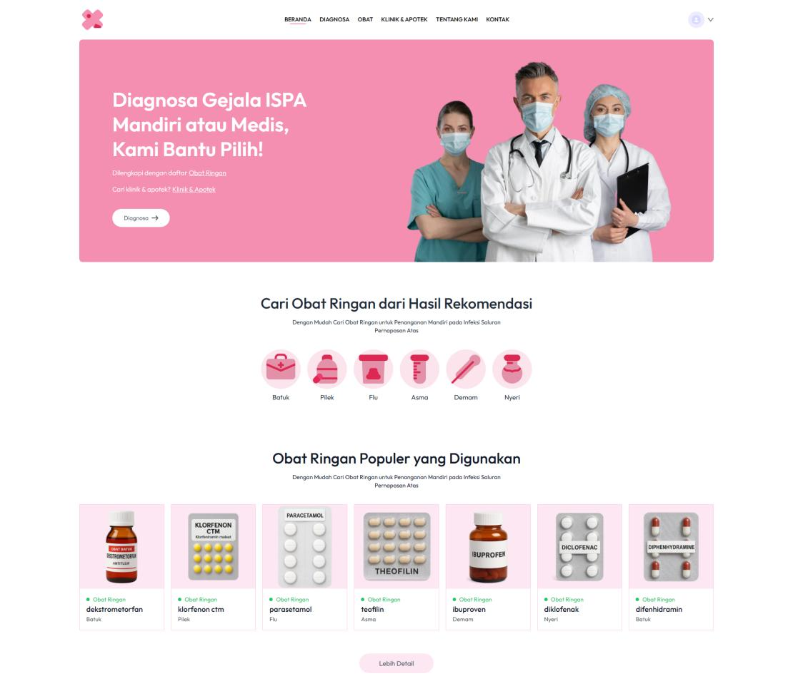
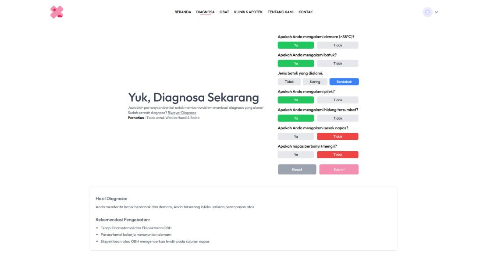
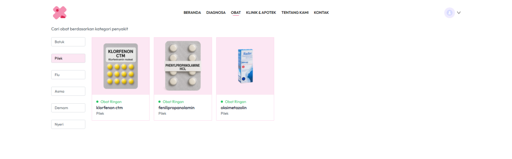
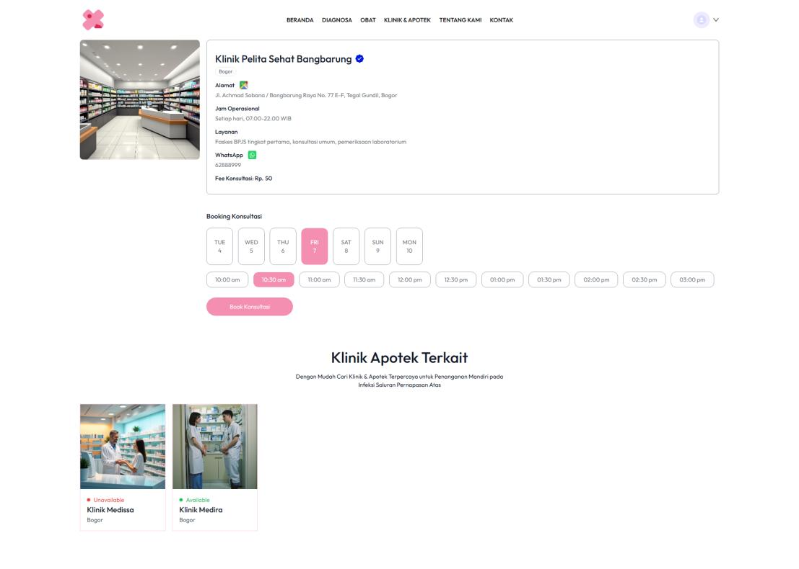
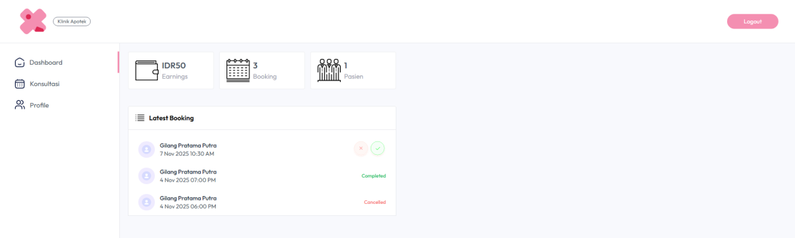
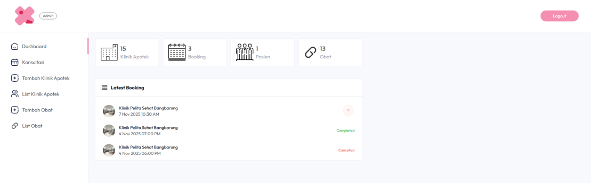

# Konsulispa

[](#tech-stack)
[](#how-the-expert-system-works)
[](#live-demo)

A web-based **expert system** that recommends **self-care (swamedikasi) and over-the-counter medication** for symptoms of **Upper Respiratory Tract Infections (URTI / ISPA)**, and lets users **book consultations** with partner clinics and pharmacies in the Greater Jakarta area (Jabodetabek).

Built as my undergraduate thesis at Pancasila University (Informatics Engineering, 2025). The user interface is in Indonesian.

> **Thesis title:** *Sistem Rekomendasi Pengobatan Gejala Infeksi Saluran Pernafasan Atas dengan Tindakan Mandiri dan Konsultasi Medis* (Recommendation System for Treating Symptoms of Upper Respiratory Tract Infections with Self-Care and Medical Consultation)

> **Disclaimer:** This project was built for academic purposes. Its recommendations are not a substitute for professional medical advice.


## Table of Contents

- [Highlights](#highlights)
- [Live Demo](#live-demo)
- [Screenshots](#screenshots)
- [Features](#features)
- [How the Expert System Works](#how-the-expert-system-works)
- [Tech Stack](#tech-stack)
- [Architecture](#architecture)
- [Getting Started](#getting-started)
- [Environment Variables](#environment-variables)
- [API Overview](#api-overview)
- [Data Models](#data-models)
- [Known Limitations](#known-limitations)
- [Author](#author)
- [License](#license)

## Highlights

- **Expert system with 54 rules** from a domain expert, using **forward chaining** for inference and **Certainty Factor** for confidence.
- **Three roles** in one platform: patient (user), clinic/pharmacy member, and admin.
- **Medicine catalogue** grouped by symptom (cough, cold, flu, asthma, fever, pain) and **clinic/pharmacy booking** by city.
- Full **MERN stack** with JWT authentication per role, bcrypt password hashing, and Cloudinary image uploads.
- Developed with the **Waterfall** software development life cycle.

## Live Demo

| App | URL | Status |
|---|---|---|
| User app | https://konsulispa.com | Offline at the moment |
| Admin / clinic panel | https://admin.konsulispa.com | Offline at the moment |

The site is currently offline. To see it in action, follow [Getting Started](#getting-started) to run it locally, or check the [screenshots](#screenshots).

## Screenshots

| Home | Diagnosis |
|---|---|
|  |  |

| Medicines | Clinic booking |
|---|---|
|  |  |

| Clinic dashboard | Admin dashboard |
|---|---|
|  |  |

## Features

**Patient (user app)**

- Register / login (JWT)
- Symptom-based diagnosis (7 questions) with treatment recommendations
- Diagnosis history, stored per user in the browser, with delete
- Browse medicines by symptom category: cough, cold, flu, asthma, fever, pain, with a detail page per medicine (therapeutic class, mechanism, indications, contraindications, side effects, dosage)
- Browse clinics and pharmacies by city (Jakarta, Bogor, Depok, Tangerang, Bekasi)
- Book a consultation by choosing a date and time slot
- View and cancel bookings (while still pending)
- Edit profile with photo upload

**Clinic / Pharmacy member (panel)**

- Dashboard: earnings, number of bookings, number of patients, latest bookings
- Approve or cancel consultation requests
- Edit clinic profile: address, hours, services, contact, fee, and availability

**Admin (panel)**

- Dashboard with system-wide statistics
- View all consultations and cancel them
- Add clinics/pharmacies and toggle their availability
- Add medicines and view the medicine list

## How the Expert System Works

The diagnosis engine runs **client-side** in the React app (`frontend/src/components/InferDiagnosis.jsx`). The knowledge base (questions and **54 rules** with expert-assigned CF values) lives in `frontend/src/assets/assets.js`.

1. **Forward chaining:** the user's answers are treated as facts. The engine fires every rule whose conditions all match, for example *cough = yes AND cough type = productive*.
2. **Certainty Factor:** each rule carries an expert-assigned CF. When several rules support the same diagnosis, their CF values are combined into a single confidence value (for two positive values: `CF1 + CF2 × (1 − CF1)`).
3. **Result:** the user gets the diagnosis and a list of recommended treatments. If no rule matches, the system falls back to advising a doctor consultation.

Example rule (simplified):

```js
{
  conditions: { batuk: true, jenis_batuk: "Berdahak" },
  result: {
    diagnosis: "Anda menderita batuk berdahak",
    treatment: ["Terapi Ekspetoran atau", "Terapi OBH", "Keduanya bekerja mengencerkan lendir"],
    cf: 0.80
  }
}
```

## Tech Stack

| Layer | Technology |
|---|---|
| User app | React, Vite, Tailwind CSS, React Router, Axios |
| Admin / clinic panel | React, Vite, Tailwind CSS |
| Backend | Node.js, Express.js |
| Database | MongoDB Atlas (Mongoose) |
| Auth and security | JWT, bcrypt, validator |
| File upload | Multer, Cloudinary |

## Architecture

```
┌────────────┐   ┌─────────────────────┐
│  frontend  │   │        admin        │
│  (patients)│   │ (admin + clinics)   │
│  :5173     │   │  :5174              │
└─────┬──────┘   └──────────┬──────────┘
      │      REST + JWT     │
      └──────────┬──────────┘
          ┌──────▼──────┐        ┌────────────┐
          │   backend   │───────▶│ Cloudinary │
          │ Express :4000│        └────────────┘
          └──────┬──────┘
          ┌──────▼──────┐
          │ MongoDB Atlas│
          └─────────────┘
```

```
konsulispa-mern/
├── frontend/   # User app (port 5173)
├── admin/      # Admin and clinic/pharmacy panel (port 5174)
└── backend/    # REST API (port 4000)
    ├── config/        # MongoDB and Cloudinary setup
    ├── models/        # user, klinikApotek, obat, appointment
    ├── routes/        # /api/user, /api/admin, /api/klinikapotek, /api/obat
    ├── controllers/
    └── middlewares/   # JWT auth per role, Multer
```

## Getting Started

### Prerequisites

- Node.js 20.19+ (the admin panel uses Vite 7; the thesis environment used Node 18 with an earlier Vite)
- A MongoDB Atlas cluster
- A Cloudinary account (cloud name, API key, API secret)

### 1. Clone

```bash
git clone https://github.com/glgpratamaputra/konsulispa-mern.git
cd konsulispa-mern
```

### 2. Backend

```bash
cd backend
npm install
```

Copy `.env.example` to `.env` and fill in your own values (see [Environment Variables](#environment-variables)), then run:

```bash
npm run server
```

Wait for `Server Started 4000` and `Database Connected`.

### 3. User app

```bash
cd frontend
npm install
```

Copy `.env.example` to `.env`, then:

```bash
npm run dev
```

Open http://localhost:5173

### 4. Admin / clinic panel

```bash
cd admin
npm install
```

Copy `.env.example` to `.env`, then:

```bash
npm run dev
```

Open http://localhost:5174.

### 5. First run: set up the data

A fresh database is empty, so set it up in this order:

1. **Admin:** log in at http://localhost:5174 with `ADMIN_EMAIL` and `ADMIN_PASSWORD` from `backend/.env`.
2. **Medicines:** add medicines on the *Tambah Obat* page.
3. **Clinics / pharmacies:** add them on the *Tambah Klinik Apotek* page. The email and password you enter there become that clinic's member login (choose "Member Klinik Apotek" on the login form).
4. **Patients:** register from the user app at http://localhost:5173.

The expert-system knowledge base ships with the frontend, so diagnosis works without any data setup.

## Environment Variables

Each folder has a `.env.example`. **Never commit a real `.env` file**, and use strong, unique values for anything that protects real data.

| Folder | Variable | Description |
|---|---|---|
| `backend` | `PORT` | API port (default `4000`) |
| | `MONGODB_URI` | MongoDB Atlas connection string, **without** a database name |
| | `CLOUDINARY_NAME`, `CLOUDINARY_API_KEY`, `CLOUDINARY_SECRET_KEY` | Cloudinary credentials for image uploads |
| | `JWT_SECRET` | Secret used to sign JWTs; use a long random string |
| | `ADMIN_EMAIL`, `ADMIN_PASSWORD` | Admin panel login |
| | optional demo-account variables | See `.env.example` |
| `frontend`, `admin` | `VITE_BACKEND_URL` | Backend URL, for example `http://localhost:4000` |

> The database name is appended in `backend/config/mongodb.js`, so `MONGODB_URI` must not include one.

Generate a strong JWT secret with:

```bash
node -e "console.log(require('crypto').randomBytes(48).toString('hex'))"
```

## API Overview

Base URL: `http://localhost:4000`. Protected routes expect the JWT in a request header: `token` (patient), `atoken` (admin) or `ktoken` (clinic member).

**Patient** (`/api/user`)

| Method | Endpoint | Auth | Description |
|---|---|---|---|
| POST | `/register` | none | Create a patient account |
| POST | `/login` | none | Log in, returns JWT |
| GET | `/get-profile` | `token` | Get own profile |
| POST | `/update-profile` | `token` | Update profile and photo |
| POST | `/book-appointment` | `token` | Book a consultation slot |
| GET | `/appointments` | `token` | List own bookings |
| POST | `/cancel-appointment` | `token` | Cancel own booking |

**Clinic / pharmacy** (`/api/klinikapotek`)

| Method | Endpoint | Auth | Description |
|---|---|---|---|
| GET | `/list` | none | Public list of clinics and pharmacies |
| POST | `/login` | none | Member login |
| GET | `/appointments` | `ktoken` | Bookings for this clinic |
| POST | `/complete-appointment` | `ktoken` | Approve / complete a booking |
| POST | `/cancel-appointment` | `ktoken` | Cancel a booking |
| GET | `/dashboard` | `ktoken` | Earnings, bookings, patients |
| GET | `/profile` | `ktoken` | Own clinic profile |
| POST | `/update-profile` | `ktoken` | Update clinic profile |

**Admin** (`/api/admin`)

| Method | Endpoint | Auth | Description |
|---|---|---|---|
| POST | `/login` | none | Admin login |
| POST | `/add-klinikApotek` | `atoken` | Add a clinic/pharmacy (with image) |
| POST | `/add-obat` | `atoken` | Add a medicine (with image) |
| POST | `/all-klinikApotek` | `atoken` | List all clinics/pharmacies |
| POST | `/all-obat` | `atoken` | List all medicines |
| POST | `/change-availability` | `atoken` | Toggle clinic availability |
| GET | `/appointments` | `atoken` | List all bookings |
| POST | `/cancel-appointment` | `atoken` | Cancel any booking |
| GET | `/dashboard` | `atoken` | System-wide statistics |

**Medicines** (`/api/obat`)

| Method | Endpoint | Auth | Description |
|---|---|---|---|
| GET | `/list` | none | Public medicine list |

## Data Models

| Model | Purpose |
|---|---|
| `user` | Patient account: name, email, hashed password, photo, address, gender, date of birth, phone |
| `klinikApotek` | Clinic/pharmacy: login, category (city), address, hours, services, contact, map and WhatsApp links, fee, availability, booked slots |
| `obat` | Medicine: category, therapeutic class, mechanism, dosage form, indications, contraindications, side effects, dosage (adult / child) |
| `appointment` | Booking linking a patient and a clinic, with slot date and time, amount, and status (pending / completed / cancelled) |

## Known Limitations

- The knowledge base is static and lives in the frontend, so changing a rule means redeploying the user app.
- Diagnosis history is stored in the browser (`localStorage`), not in the database.
- Consultations are booked and tracked in the app, but there is no online payment gateway.
- This is an academic prototype, not a certified medical device. Medicine data should be reviewed by a pharmacist before any real-world use.

## Author

**Gilang Pratama Putra**, Informatics Engineering graduate, Pancasila University

- Email: glgpratamaputra@gmail.com
- GitHub: [@glgpratamaputra](https://github.com/glgpratamaputra)

## License

Released under the [MIT License](LICENSE).
